# Sö 128, Lids kyrka: huggteknik dokumenterad med 3D-skanning

Viktor Kvant, Vitki
2026-10-20

## Sammanfattning

Artikeln redovisar en 3D-baserad analys av huggspåren på Sö 128 (Lids kyrka). Totalt 295 tvärsnitt mättes; för runor är V-vinkeln i medel 139,7° (SD 12,5) och spårdjupet 1,78 mm.

## 1. Inledning

Syftet är att dokumentera huggtekniken på stenen med mätbara spårvariabler ur en 3D-skanning, så att den kan jämföras med andra stenar och prövas mot tidigare attribueringar. Frågeställningarna formuleras av författaren.

## 2. Stenen och inskriften

|  |  |
|---|---|
| Signum | Sö 128 |
| Plats | Lids kyrka, Lids sn, Rönö hd, Nyköping |
| Placering | Vid kyrkogårdsporten. |
| Föremål och material | runsten, sandsten |
| Ristare (Rundata) | – |
| Stilgrupp (Rundata) | Pr2 |
| Datering (Rundata) | vikingatid (V) |
| Ornamentik | – |
| Skick | vittring medel |

*Tabell 1. Uppgifter om Sö 128.*

Berggrund: Stenens material (sandsten) finns inte i berggrunden inom 10 km enligt SGU. Stenen kan vara ett flyttblock eller ha fraktats dit – värt att undersöka. Runstenar är ofta flyttblock eller transporterade; avvikelse från berggrunden är en ledtråd, inte ett fel. (Källa: Sveriges geologiska undersökning (SGU), Berggrund 1:50 000–1:250 000 (visningstjänst).)

### Inskriften

> **þoruþr : auk : stainbog : þaR : rasa : stan : at : moþur : sina · stanfriþi ak : kar : a(t) : kunu sina :**
>
> *Þoruðr ok Stæinborg þaR ræisa stæin at moður sina Stæinfriði ok Karr at kunu sina.*
>
> *Þórunnr ok Steinbjôrg þær reisa stein at móður sína Steinfríði ok Kárr at konu sína.*
>
> ”Þórunnr and Steinbjôrg, they raise the stone in memory of their mother Steinfríðr; and Kárr in memory of his wife.”

Translitterering i fetstil och normalisering till runsvenska respektive fornvästnordiska i kursiv, enligt Samnordisk runtextdatabas. Översättningen är Rundatas engelska. Ristare anges med S (signerad), A (attribuerad); frågetecken markerar en osäker uppgift.

Inskriften är utgiven i Sveriges runinskrifter (Brate & Wessén 1924–1936). Tidigare tolkningar och attribueringar bör kontrolleras där och i senare litteratur innan resultaten nedan ställs mot dem.

### Inskriftens syfte

Sö 128 hör enligt appens katalogisering till minnesinskrift (rest eller huggen till minne av någon ("æftiR", "in memory of"); 68 % av de vikingatida runstenarna med text). Kategorierna sätts med regler på Rundatas normalisering och översättning.

### Stenen i forskningsläget

|  |  |
|---|---|
| Ristare i Rundata | ingen angiven |
| Säker stilgrupp | ja (Pr2) |
| Osäker tolkning | nej |
| Daterad med årtal | nej |
| Försvunnen | nej |
| Södermanland: runstenar med ristare | 125 av 363 (34 %) – ristaruppgifterna bygger främst på Axelson (1993) |
| Södermanland: osäkert tolkade / försvunna | 94 / 69 |

*Tabell 2. Sö 128 i Forskningsluckor.*

Stenen saknar ristare i Rundata men finns inte bland Forskningsluckors ortografiska hypoteser, som kräver likhet minst 0,6, marginal minst 0,05 och minst åtta läsbara ord. Den ortografiska jämförelsen skiljer inte tydligt mellan ristarna: Ärnfast 0,69 mot Tidkume 0,69, en marginal under 0,05.

Uppgifterna kommer ur Samnordisk runtextdatabas. Ristaruppgifterna för Södermanland, Uppland, Västmanland och Gästrikland bygger främst på Axelson (1993); i andra landskap kan attribueringar finnas i litteraturen utan att vara inlagda i Rundata.

## 3. Material och metod

### 3.1 3D-dokumentation

|  |  |
|---|---|
| Skanner | Laila Kitzler Åhfeldt, RAÄ (Zenodo 10.5281/zenodo.11951255) |
| Skannat av, datum | Laila Kitzler Åhfeldt |
| Punktavstånd / upplösning | – (fyll i) |
| Noggrannhet | – (fyll i) |
| Modellfil | So 128_1_4 thin closed holes.stl |
| Hörn / trianglar | 736569 / 1462833 |
| Utsträckning | 970 × 1348 × 129 mm |
| Kontrollsumma (SHA-256) | 004ae2df06ef8be424d00e30102838de601093d3fc3f69bf47c4bf7a24b9f717 |
| Publicerad skanning | https://doi.org/10.5281/zenodo.11951255 (Kitzler Åhfeldt 2024a) |
| Licens för skanningen | CC BY 4.0 |

*Tabell 3. 3D-dokumentation och paradata.*

Bilderna av ytan i figurerna är räknade direkt ur 3D-modellen: modellen projiceras på den ristade sidans plan till ett höjdfält, som belyses digitalt (strykljus) eller jämförs med en rekonstruerad stenyta (morfologisk stängning med 20 mm skala) för att visa djupet. Ingen bild är retuscherad.

### 3.2 Mätning av huggspår

Huggspåren mättes med Vitki 2.0.0 (mätmetod groove-5). Spåren hittades automatiskt som fördjupningar under den rekonstruerade stenytan; tvärsnitt lades med jämna mellanrum längs spårens mittlinjer vinkelrätt mot spårets riktning, och varje snitt granskades mot kvalitetskriterier (väggpassning, rimlig vinkel, djup över brusnivån, spårkanter inom snittet). Bara spår som känns igen som runor mättes: mittlinjerna delades i streck, och bara raka, jämnbreda streck av runors längd som står i rader – på stenar med slingband inne i banden – räknades som runor; slinglinjer, ornamentik och oregelbundna spår (möjliga sprickor) sorterades bort. I varje tvärsnitt anpassas spårväggarna med linjär regression mellan 20 och 80 procent av spårdjupet; V-vinkeln är öppningsvinkeln mellan väggarnas linjer, bredden mäts där linjerna når stenytans nivå och djupet från spårkanten till botten. Bottenradien är krökningsradien hos en parabel anpassad kring botten och ytråheten medelavvikelsen från väggarnas linjer. Metoden är validerad på syntetiska spår med kända mått (vinkelfel inom ±0,6°). Runor och ornamentik redovisas var för sig. Analysen följer Vitki-protokollet för automatisk huggspårsmätning (vitki-groove-1-utkast).

| Utfall | Antal snitt |
|---|---|
| Kandidater | 2325 |
| Godkända | 295 |
| Igenkända runor | 58 |
| Runor med godkända snitt | 50 |
| Underkända: inte runa: långt eller böjt spår (ornamentik/slingkant) | 854 |
| Underkända: inte runa: kort, krokigt eller ojämnt spår (möjlig spricka) | 822 |
| Underkända: inte runa: ensamt rakt spår utan andra runor intill | 256 |
| Underkända: för grunt | 40 |
| Underkända: dålig väggpassning | 34 |
| Underkända: spårkant hittades inte | 11 |
| Underkända: för få punkter i snittet | 10 |
| Underkända: för smalt för upplösningen | 2 |
| Underkända: orimlig vinkel | 1 |

*Tabell 4. Kvalitetskontroll av de automatiska tvärsnitten.*

| Parameter | Värde |
|---|---|
| mode | automatic |
| normal | -0,110, -0,019, 0,994 |
| up | 0,994, -0,002, 0,110 |
| resolution_mm | 0,600 |
| mesh_point_spacing_mm | 1,133 |
| harmonize_mm | None |
| fixed_resolution | True |
| reference_scale_mm | 20,000 |
| noise_mm | 0,262 |
| threshold_mm | 0,786 |
| sensitivity | 3,000 |
| spacing_mm | 3,000 |
| edge_margin_mm | 10,000 |
| min_fit_r2 | 0,800 |
| max_halfwidth_mm | 8,000 |
| max_slope_deg | 45,000 |
| runes_only | True |
| rune_min_mm | 12,000 |
| rune_max_mm | 250,000 |
| image_scale | 0,713 |
| meta_stone | Okänd |
| meta_weathering | Medel |

*Tabell 5. Analysparametrar (för reproducerbarhet).*

### 3.3 Statistik

Varje mått sammanfattas med medelvärde, standardavvikelse och 95 % konfidensintervall för medelvärdet (t-fördelning). Runor och ornamentik jämförs med permutationstest per mått (Bonferroni-justerat) och samlat. Jämförelsen med andra stenar använder stenarnas medelvärden i Vitkis mätkorpus och Mahalanobisavstånd till ristarnas medelvärden, med lämna-en-ute-korsvalidering av träffsäkerheten; bara stenar med en säker signerad eller attribuerad ristare i Rundata används som referens.

## 4. Resultat

### 4.1 Ytan

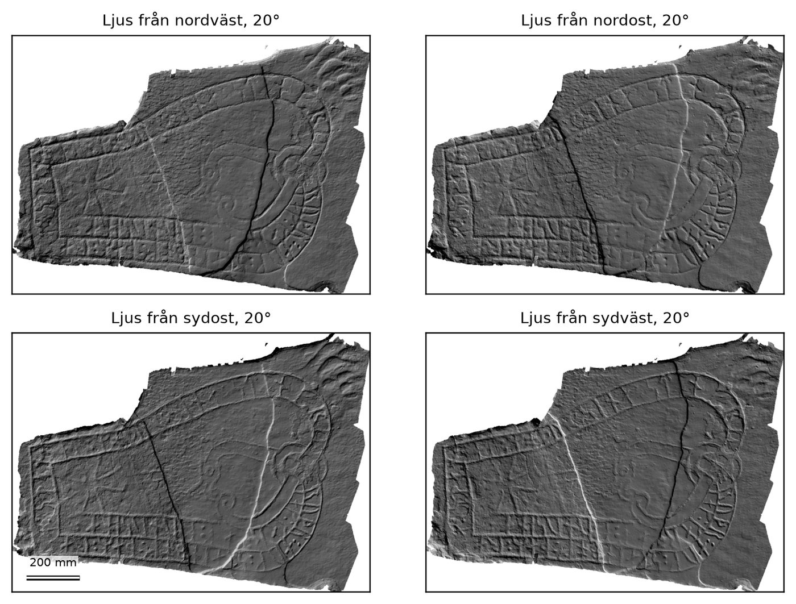

*Figur 1. Sö 128. Digitalt strykljus från fyra riktningar (20° över ytan), beräknat ur 3D-modellen.*

*Figur 2. Sö 128. Djup under den rekonstruerade stenytan; mörkare = djupare. Kantzonen (10 mm), där referensytan är osäker, är utelämnad. Kartan visar formen; spårdjupen i tabellerna är mätta i tvärsnitten och är något större, eftersom referensytan är utjämnad.*

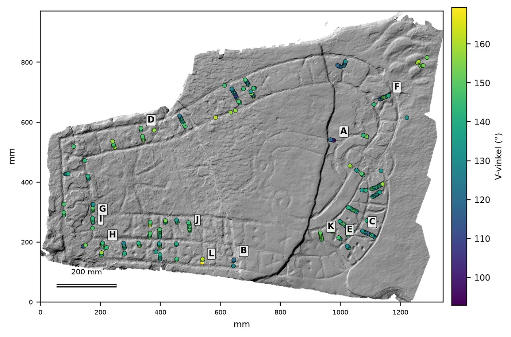

*Figur 3. Sö 128. Tvärsnittens positioner färgade efter V-vinkel. Bokstäverna hänvisar till profilerna i figuren över representativa tvärsnitt.*

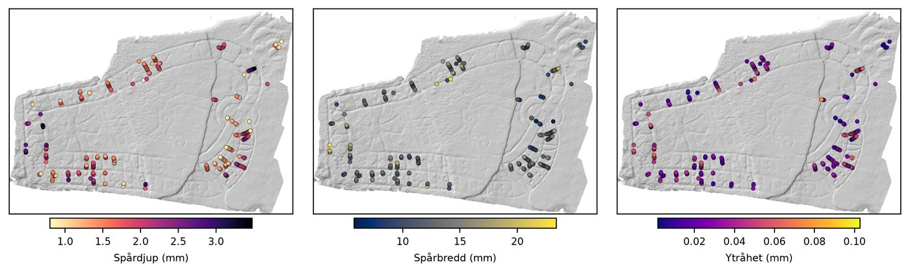

*Figur 4. Sö 128. Spårdjup, spårbredd och ytråhet per tvärsnitt över ytan.*

### 4.2 Spårprofiler

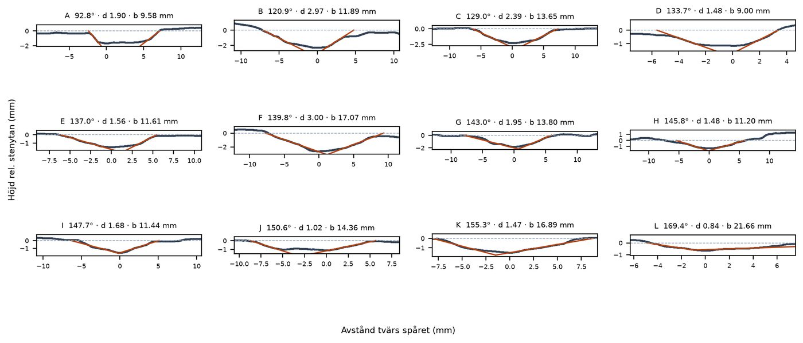

*Figur 5. Sö 128. Representativa tvärsnitt, ordnade från minsta till största V-vinkel. Punkter: uppmätt profil; röda linjer: anpassade spårväggar; streckad linje: stenytans nivå. Lika skala på axlarna.*

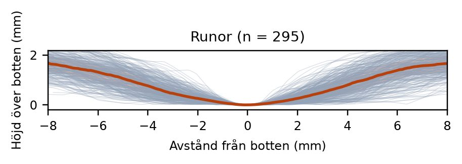

*Figur 6. Sö 128. Alla tvärsnitt överlagrade med botten i origo; median (heldragen) och interkvartilområde (skuggat).*

### 4.3 Spårmått

| Spår | Mått | n | Medel | SD | 95 % KI | Min–max |
|---|---|---|---|---|---|---|
| Runor | V-vinkel (°) | 295 | 139,7 | 12,5 | 138,3–141,2 | 92,8–169,4 |
| Runor | Asymmetri (°) | 295 | 8,2 | 6,9 | 7,5–9,0 | 0,0–37,2 |
| Runor | Spårdjup (mm) | 295 | 1,78 | 0,54 | 1,71–1,84 | 0,80–3,48 |
| Runor | Spårbredd (mm) | 295 | 13,29 | 3,22 | 12,92–13,66 | 5,76–23,39 |
| Runor | Djup/bredd | 295 | 0,14 | 0,04 | 0,13–0,14 | 0,04–0,25 |
| Runor | Bottenradie (mm) | 295 | 6,78 | 4,44 | 6,27–7,29 | 1,38–30,44 |
| Runor | Ytråhet (mm) | 295 | 0,033 | 0,018 | 0,031–0,035 | 0,002–0,103 |

*Tabell 6. Spårmått för Sö 128.*

Runor (295 tvärsnitt): V-vinkeln är i medel 139,7° (SD 12,5°, 95 % KI 138,3–141,2°, spridning 92,8–169,4°), spårdjupet 1,78 mm (SD 0,54) och spårbredden 13,29 mm (SD 3,22); se tabell 6.

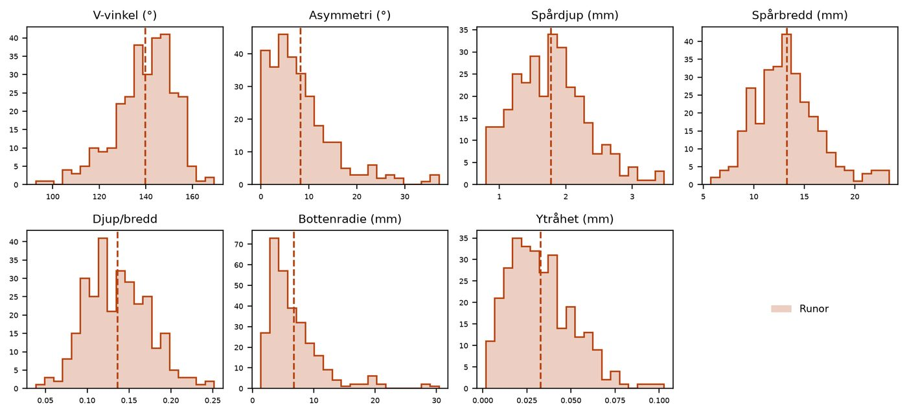

*Figur 7. Sö 128. Fördelning av måtten per tvärsnitt; lodrät linje = medelvärde.*

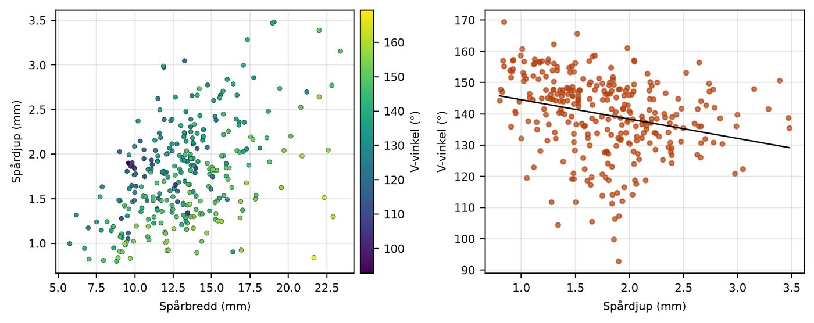

*Figur 8. Sö 128. Samband mellan spårbredd, spårdjup och V-vinkel per tvärsnitt.*

### 4.4 Jämförelse med andra stenar

Mätkorpusen innehåller ännu för få stenar med säker ristare för en jämförelse.

### 4.5 Bild och runformer

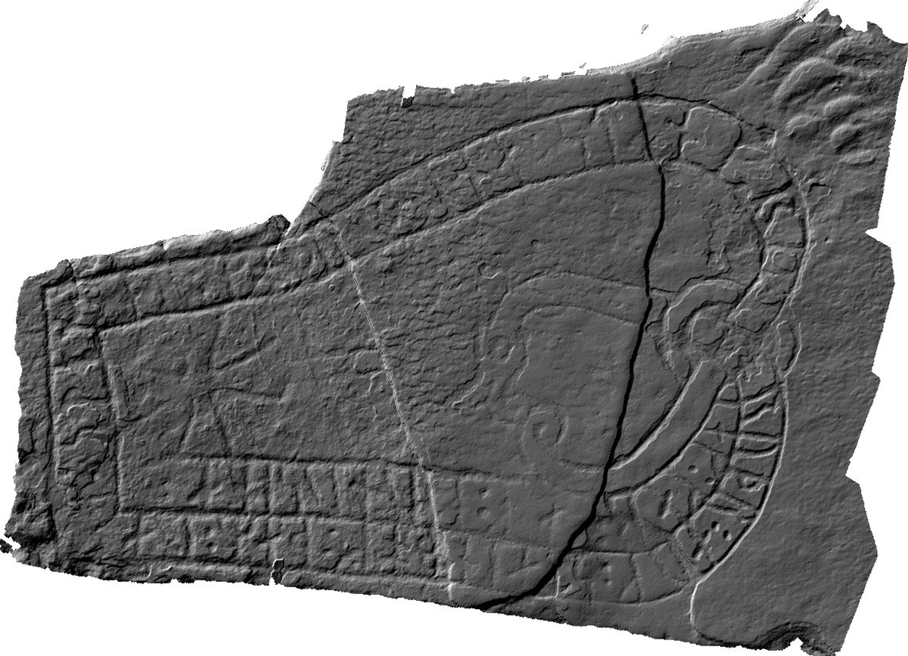

*Figur 9. Sö 128. Digitalt strykljus från nordväst, räknat ur 3D-skanningen – bilden som 2D-analysen och läsningen fick.*

### 4.6 Läsning och luckor (sannolikhetsmodellen)

Sannolikhetsmodellen (textmodel-18, METHODS.md 8.1) läser inskriftens huggna runföljder utan att använda Rundatas tolkning och föreslår ord för förlorade runor med en kalibrerad procent – ett mått som är prövat mot luckor där svaret är känt ur äldre dokumentation. I det provet valde modellen rätt ord i 69 procent av luckorna, och när den anger minst 95 procent stämmer ordet i 99 procent av fallen. Inskriften läses alltid av en modell som inte har tränats på den.

Av läsningens 16 ord ligger 7 på minst 95 procent.

Ur språket daterar modellen inskriften till 1070–1150 (59 %). Rundata anger V. Dateringen träffar rätt epok i omkring sex fall av tio och är högst en epok fel i nio av tio; den är ett stöd, inte ett facit.

### 4.7 Attribuering

Beläggen från Rundata, ortografisk stilometri och huggteknik vägs samman; ortografi och huggteknik vägs efter metodens korsvaliderade träffsäkerhet i fallet. Kandidaterna prövas mot geografi, ristarens stilgrupper och, där ristarens stenar är uppmätta, sten mot sten med permutationstest. Inga sannolikheter anges.

Rundata anger ingen ristare. Beläggen pekar på Tidkume (svaga belägg) – en hypotes att pröva, inte en attribuering. 4 motsägelser mellan källorna redovisas.

| Ristare | Belägg | Poäng | Källor | Mot Rundata |
|---|---|---|---|---|
| Tidkume | svag | 0,3 | Ortografi | nytt |
| Ärnfast | svag | 0,3 | Ortografi | nytt |
| Torbjörn 2 | svag | 0,1 | Ortografi | nytt |

*Tabell 7. Attribueringskandidater för Sö 128.*

- Tidkume, geografi: Närmaste signerade eller attribuerade sten av Tidkume ligger 54 km bort. Ristarens kända landskap: U (20), Sö (4), Vs (1).
- Tidkume, stilgrupper: Stilgrupper på ristarens stenar (utan frågetecken i Rundata): Pr4 (14), Pr3 (4). Kärnan (stilgrupper på minst en tiondel av stenarna: Pr3, Pr4) motsvarar ungefär 1050–1100 enligt Gräslunds kronologi. Stenens stilgrupp Pr2 ligger inom kärnans tidsram men finns bara på 0 av 18 av ristarens stenar; den är möjlig men ovanlig för ristaren och avgör inte frågan.
- Tidkume, bergart: Stenen: sandsten. Säkra stenar av Tidkume med uppgift (22): granit (12), ljus granit (2), brun sandsten (1), mörk grovkornig granit (1). Bergarten förekommer sällan eller aldrig hos ristaren.
- Tidkume, språkdrag: Av 11 jämförbara språkdrag talar 3 för Tidkume (stenens form är tydligt vanligare hos ristaren än på andra stenar i Sö), 2 emot (tydligt ovanligare hos ristaren) och 6 skiljer inte. För: diftongen au i 'och' (monoftong: 83 % hos ristaren mot 12 % i Sö, bara 6 inskrifter); diftongen ai i alla ord (monoftong: 82 % hos ristaren mot 19 % i Sö); o-runan för o-ljud (båda: 0 % hos ristaren mot 3 % i Sö, bara 4 inskrifter). Emot: stungen k (g) (ja: 0 % hos ristaren mot 15 % i Sö); ristarsignatur (nej: 50 % hos ristaren mot 90 % i Sö). Drag med färre än 10 jämförbara inskrifter hos ristaren är osäkra (diftongen au i 'och': 6; ʀ skrivet med r: 9; o-runan för o-ljud: 4). Sammantaget är stenens språkdrag 4,8 gånger så vanliga hos Tidkume som på andra stenar i Sö; 4 % av 219 andra stenar där passar ristarens profil minst lika bra (p 0,036). Skillnaden mot landskapet är statistiskt signifikant.
- Ärnfast, geografi: Närmaste signerade eller attribuerade sten av Ärnfast ligger 62 km bort. Ristarens kända landskap: U (12).
- Ärnfast, stilgrupper: Stilgrupper på ristarens stenar (utan frågetecken i Rundata): Pr3 (6), Pr4 (6). Kärnan (stilgrupper på minst en tiondel av stenarna: Pr3, Pr4) motsvarar ungefär 1050–1100 enligt Gräslunds kronologi. Stenens stilgrupp Pr2 ligger inom kärnans tidsram men finns bara på 0 av 12 av ristarens stenar; den är möjlig men ovanlig för ristaren och avgör inte frågan.
- Ärnfast, bergart: Stenen: sandsten. Säkra stenar av Ärnfast med uppgift (6): granit (4), gråsten (1), gnejs (1). Bergarten förekommer sällan eller aldrig hos ristaren.
- Ärnfast, språkdrag: Av 11 jämförbara språkdrag talar 3 för Ärnfast (stenens form är tydligt vanligare hos ristaren än på andra stenar i Sö), 1 emot (tydligt ovanligare hos ristaren) och 7 skiljer inte. För: o-runan för o-ljud (båda: 20 % hos ristaren mot 3 % i Sö, bara 5 inskrifter); diftongen au i 'och' (monoftong: 22 % hos ristaren mot 12 % i Sö, bara 9 inskrifter); stungen k (g) (ja: 27 % hos ristaren mot 15 % i Sö). Emot: diftongen ai i alla ord (monoftong: 0 % hos ristaren mot 19 % i Sö, bara 7 inskrifter). Drag med färre än 10 jämförbara inskrifter hos ristaren är osäkra (diftongen au i 'och': 9; diftongen ai i alla ord: 7; o-runan för o-ljud: 5). Sammantaget är stenens språkdrag 3,6 gånger så vanliga hos Ärnfast som på andra stenar i Sö; 6 % av 219 andra stenar där passar ristarens profil minst lika bra (p 0,064). Skillnaden mot landskapet är inte statistiskt signifikant.
- Torbjörn 2, geografi: Närmaste signerade eller attribuerade sten av Torbjörn 2 ligger 59 km bort. Ristarens kända landskap: U (21).
- Torbjörn 2, stilgrupper: Stilgrupper på ristarens stenar (utan frågetecken i Rundata): Pr1 (4), KB (2), Fp (2), RAK (1), Pr3 (1). Kärnan (stilgrupper på minst en tiondel av stenarna: KB, RAK, Pr1, Fp, Pr3) motsvarar ungefär 980–1080 enligt Gräslunds kronologi. Stenens stilgrupp Pr2 ligger inom kärnans tidsram men finns bara på 0 av 10 av ristarens stenar; den är möjlig men ovanlig för ristaren och avgör inte frågan.
- Torbjörn 2, bergart: Stenen: sandsten. Säkra stenar av Torbjörn 2 med uppgift (19): granit (10), sandsten (3), blågrå glimmerskiffer (1), grå kornig stenart (1). Sandsten är inte tydligt vanligare hos ristaren (21 %) än på runstenarna i landskapet i stort (21 %; kvot under 1,5), så bergarten skiljer inte ristare åt.
- Torbjörn 2, språkdrag: Av 11 jämförbara språkdrag talar 4 för Torbjörn 2 (stenens form är tydligt vanligare hos ristaren än på andra stenar i Sö), 2 emot (tydligt ovanligare hos ristaren) och 5 skiljer inte. För: o-runan för o-ljud (båda: 12 % hos ristaren mot 3 % i Sö, bara 8 inskrifter); diftongen ai i alla ord (monoftong: 43 % hos ristaren mot 19 % i Sö); diftongen au i 'och' (monoftong: 17 % hos ristaren mot 12 % i Sö, bara 6 inskrifter); skiljetecken (kolon: 88 % hos ristaren mot 48 % i Sö). Emot: stungen i (e) (nej: 14 % hos ristaren mot 56 % i Sö); ʀ skrivet med r (ʀ-runa: 46 % hos ristaren mot 92 % i Sö). Drag med färre än 10 jämförbara inskrifter hos ristaren är osäkra (diftongen au i 'och': 6; o-runan för o-ljud: 8). Sammantaget är stenens språkdrag 3,3 gånger så vanliga hos Torbjörn 2 som på andra stenar i Sö; 8 % av 219 andra stenar där passar ristarens profil minst lika bra (p 0,082). Skillnaden mot landskapet är inte statistiskt signifikant.

| Ristare | Stilgrupp Pr2 | Minnesinskrift |
|---|---|---|
| Tidkume | 0 av 18 (0 %) | 8 av 12 (67 %) |
| Ärnfast | 0 av 12 (0 %) | – |
| Torbjörn 2 | 0 av 10 (0 %) | 13 av 17 (76 %) |

*Tabell 8. Hur ofta kandidaterna ristade i Sö 128s stilgrupp och inskriftstyp (säkra inskrifter i Rundata; stilgrupp av inskrifter med säker stilgrupp, typ av vikingatida runstenar med text).*

Motsägelser mellan källorna:

- Tidkume: stenens bergart (sandsten) förekommer sällan hos ristaren.
- Ärnfast: geografiskt tveksamt – Närmaste signerade eller attribuerade sten av Ärnfast ligger 62 km bort. Ristarens kända landskap: U (12).
- Ärnfast: stenens bergart (sandsten) förekommer sällan hos ristaren.
- Torbjörn 2: geografiskt tveksamt – Närmaste signerade eller attribuerade sten av Torbjörn 2 ligger 59 km bort. Ristarens kända landskap: U (21).

Belägg som saknas:

- Huggteknik: mätkorpusen ingår inte i körningar från terminalen (kräver inloggning).

## 5. Diskussion

Diskussionen skrivs av författaren utifrån resultaten ovan.

### Kända brister och begränsningar

Vitki redovisar metodens kända brister i varje analys (förteckning version 2026-10-20; se METHODS.md, avsnitt 18). Punkterna nedan gäller den här analysen.

- Måtten är inte validerade som spår av ristarens hand. Huggspårsmåtten beskriver spårens form men är inte visade att skilja ristare åt. När den automatiska analysen kördes på Kitzler Åhfeldts 36 skanningar från Södermanland (2026) återskapades inte hennes indelning i grupper, och bergarten påverkade måtten mer än ristaren; ett svagare samband med Rundatas ristare fanns kvar efter kontroll för bergart (utforskande). Samma sak gällde när bara runorna mättes enligt Vitki-protokollet (groove-5): hennes Rak 1 och Rak 2 skildes inte åt (p 0,43), medan ristar- och materialsignalen kvarstod. Med appens egen attribuering (lämna-en-ute, Mahalanobis) på samma 36 stenar (2026-10-20) hamnade rätt ristare först i 58 % av fallen för tolv stenar av fem ristare, men en gissning efter bergarten ensam träffar 50 %, och slumpade ristarnamn inom samma bergart når 34 % (p 0,10); med appens strängare urval (åtta stenar, tre ristare) 38 % mot 50 % för bergartsgissningen. Huggtekniken vägs därför in mot den högre av slumpnivån och bergartsgissningen, och i det enda referensmaterialet med kända ristare väger den inget. Skillnader mellan stenar kan därför bero på bergart, vittring och skanning lika väl som på ristare. Behövs: Stenar med känd ristare på samma bergart, jämförelse med Groove Measure-data och gärna experimentella ristningar med kända ristare och verktyg.
- Bottenradie och asymmetri är osäkra mått. Bottenradien beror fortfarande på skanningens punkttäthet (r = 0,44 mellan stenar) och skiljer knappt stenar åt. Asymmetrin varierar så mycket mellan snitt och runor att stenens medelvärde är osäkert (tillförlitlighet 0,75 med 10 runor, 0,9 först med 30) och ändras när analysen ändras (ICC 0,40 i robusthetsstudien). V-vinkel, djup, bredd och djup/bredd är stabilare. Behövs: Bättre bottenmodell och test på skanningar av samma sten med olika punkttäthet.
- Ingen sten är mätt i oberoende skanningar. Robusthetsstudien (METHODS.md 2e, åtta stenar) visar att stenens medelvärden för vinkel, djup, bredd och djup/bredd står sig när rutnät, ytnormal, känslighet och skanningens täthet ändras (ICC 0,95–0,98), men vilka ställen som mäts ändras mycket, samma ställe skiljer ca 2° i vinkel, djupet beror på ytnormalen och glesa skanningar ger upp till 9° annan vinkel. Ingen sten har mätts i två oberoende skanningar, och manuell och automatisk mätning på samma ställen på Sö 113 skilde i median 6°. Valideringen på syntetiska stenar (idealiska V-spår) visar att beräkningen är rätt, inte att knackade, U-formade och vittrade spår mäts rätt. Lav och ommålning påverkar också resultatet. Behövs: Test–omtest med oberoende skanningar av samma stenar, och manuell mot automatisk mätning; samma rutnät och känslighet för alla stenar som jämförs.
- Inte jämförbart med tidigare 3D-studier utan kalibrering. Måtten är inte verifierade som likvärdiga med Groove Measure-variablerna i Kitzler Åhfeldts studier (t.ex. hennes 'ideal depth' räknas annorlunda), och urvalet skiljer sig: hon valde de bäst bevarade spåren, medan den automatiska analysen mäter alla igenkända runor och därför får med mer vittring. Behövs: Samma referensstenar mätta med båda metoderna.
- Runigenkänningen är inte utvärderad. Vilka spår som räknas som runor avgörs av regler som justerats för hand på Sö 113 och Sö 128, inte prövats mot handmärkta stenar, så träffsäkerheten (andel mätta streck som verkligen är runor, andel runor som hittas) är okänd. Antalet igenkända runor på 19 skanningar var i median 0,9 gånger antalet runor i Rundatas translitterering men varierade från 0,3 (grunda, vittrade runor som faller sönder, t.ex. Sö 160 och Sö 206) till 1,5 (Sö 143, där korsarmar bitvis togs för runor); på Sö 371, utan läsbara runor i Rundata, hittades sex. Slinglinjer som brutits av vittring kan räknas som runor, och runor kan delas eller slås ihop. På Sö 164 (2026-10-14) låg 18 av 67 igenkända runor i bildfältets skepp och kors. Programmet fångar mest huvudstavarna: på 37 skanningar i Södermanland fann det i median 1,2 runstreck per runa, fast runorna där i genomsnitt har omkring två streck, eftersom bistavar som är korta, böjda eller bryts där de möter huvudstaven sorteras bort. Det beror på programmet, inte på stenarna: på Sö 164, där 45 av 49 runor i runbanden blev en ensam stav, syns bistavarna i strykljus (rättat 2026-10-16). Tre regeländringar (längdgränsen för ramlinjer räknad på hela stavar, krav på parallella grannar i rad, båda tillsammans) prövades på sju stenar: de minskade felen på vittrade stenar med stora figurfält (Sö 164, Sö 45) men tappade runor på välbevarade och figurrika stenar (Sö 128, Sö 205), och infördes därför inte. Granska alltid granskningsbilden och märk figurfältet som ornamentik där det behövs. Behövs: Handmärkta facit för 8–10 stenar som inte använts för att justera reglerna (facit-läget i 3D-vyn, scripts/evaluate_rune_detection.py), med låsta regler. En automatisk motkontroll ur djupbilden (src/trace_reader.rune_depth_check) prövades 2026-10-19 men hölls utanför driften: på två stenar gav den viss signal åt rätt håll för formlösa bistavsmönster men flaggade också var åttonde runa på en välbevarad sten, och bindrune-vakten slog åt fel håll. Även den väntar på facit.
- Gränserna 10 och 20 runor är riktvärden. Riktvärdena (10 runor för att beskriva en sten, 20 för att jämföra stenar) bygger på 18 stenar mätta med samma metod, bland dem de två som runigenkänningen justerades på. Skillnaderna mellan stenarna omfattar bergart och punkttäthet, vilket får tillförlitligheten att se bättre ut än den är, och igenkänningstestet jämförde två halvor av samma skanning. För att skilja ristare på samma bergart behövs fler runor. Behövs: Ny beräkning när test–omtest och stenar med känd ristare på samma bergart finns.
- Attribueringen riskerar att bli cirkulär. Rundatas ristaruppgifter är hypoteser i litteraturen, i Mälardalen främst Axelsons (1993), som själv vägde in stil, stavning och geografi – samma slags drag som modellerna använder. Korsvalideringen mäter därför överensstämmelse med tidigare bedömningar, inte med en oberoende sanning. Behövs: Prövning på signerade stenar som inte använts i träningen och med variabler som inte låg bakom attribueringarna.
- Träffsäkerheten beror på om platsen är känd. Vid slumpvis korsvalidering hamnar stenar från samma plats både i tränings- och testdata. R-modellen redovisas därför också med hela socknar och härader utelämnade: rätt ristare 72 % slumpvis, 68 % på en ny socken och 57 % i ett nytt härad (geografi ensamt 44, 40 och 30 %). Sannolikheterna för enskilda stenar kommer från den slumpvisa korsvalideringen och gäller en ny sten på en känd plats. Mätkorpusens attribuering (lämna-en-ute) är inte grupperad. Behövs: Grupperad korsvalidering även för mätkorpusens attribuering, när korpusen är stor nog.
- Många utforskande test på samma data. Plattformen kör många analyser på samma korpus (ortografi, språkdrag, R-modeller, Forskningsluckor, syntes). P-värdena är justerade inom varje analys men inte över plattformen som helhet. Ett automatiskt fynd är en hypotes att pröva med en förhandsbestämd analysplan, inte ett resultat. Behövs: Förregistrerade analysplaner för de hypoteser som ska publiceras.
- Stenarnas mått är ofullständiga och ojämna. Måtten läses ur Kulturmiljöregistrets fritext och finns för knappt hälften av de vikingatida runstenarna (1 101 av 2 321 med höjd). Höjden är oftast höjden över mark, inte stenens hela längd, och stenar har flyttats och rests om. Fornlämningar med flera stenar som inte går att skilja åt är uteslutna, liksom fragment. Statusord och antal namn är grova mått på resarnas makt. Behövs: Mått ur Sveriges runinskrifter eller nya mätningar för stenarna som saknas; hela höjden för resta stenar.
- Rundata är en äldre utgåva. Appen bygger på Samnordisk runtextdatabas version 3.1 (2018); nyare förslag stäms av mot Runor (2020) och Wikidata men inte mot senare litteratur. Ristare, stilgrupper och dateringar är bedömningar, inte facit. Behövs: Uppdatering till senaste utgåvan av Runor.
- Programvaran är under utveckling. Mätmetoden har ändrats flera gånger (groove-1 till groove-5 under oktober 2026) efter att fel hittats. Resultat är bara jämförbara inom samma metodversion, som anges i varje analys. Koden är inte granskad av utomstående, och ingen låst version med DOI finns ännu. Behövs: Låst version med DOI (Zenodo) och extern granskning av koden.

## Data och reproducerbarhet

Mätningarna är gjorda med Vitki 2.0.0, mätmetod groove-5. Modellfilen identifieras med kontrollsumman ovan, och parametrarna i tabellen räcker för att upprepa analysen. Tvärsnittens mått finns i bilagan; råprofilerna kan publiceras i Vitkis mätkorpus (CC BY 4.0).

## Tack

Skanningen av Sö 128 är gjord av Laila Kitzler Åhfeldt inom forskningsprojektet Runristandets dynamik (2009–2014) och publicerad med licensen CC BY 4.0 (Kitzler Åhfeldt 2024a; doi:10.5281/zenodo.11951255). Vi tackar för att datamängden gjorts fritt tillgänglig. Bara inskriftsytorna är skannade. Fyll i: markägare, länsstyrelse, finansiärer.

## Referenser

- Brate, E. & Wessén, E. 1924–1936. Södermanlands runinskrifter. (Sveriges runinskrifter 3.) Stockholm.
- Gräslund, A.-S. 1998. Ornamentiken som dateringsgrund för Upplands runstenar. I: Innskrifter og datering / Dating inscriptions. Trondheim, s. 73–91.
- Kitzler Åhfeldt, L. 2002. Work and Worship. Laser Scanner Analysis of Viking Age Rune Stones. Stockholms universitet.
- Kitzler Åhfeldt, L. 2024. 3D-data Runstenar i Södermanland / Runestones in Södermanland [Dataset]. Riksantikvarieämbetet. https://doi.org/10.5281/zenodo.11951255
- Kitzler Åhfeldt, L. & Imer, L. M. 2019. Rune Carvers and Sponsor Families on Bornholm. Danish Journal of Archaeology 8. https://doi.org/10.7146/dja.v8i0.113226
- Samnordisk runtextdatabas. Institutionen för nordiska språk, Uppsala universitet. http://www.nordiska.uu.se/forskn/samnord.htm
- Vitki, version 2.0.0. Programvara. https://vitkirunor.se (källkod: https://github.com/Precatio/runes)

## Bilaga A. Mått per tvärsnitt

| # | Spår | Profil | V-vinkel (°) | Asymmetri (°) | Spårdjup (mm) | Spårbredd (mm) | Djup/bredd | Bottenradie (mm) | Ytråhet (mm) | R² |
|---|---|---|---|---|---|---|---|---|---|---|
| 1 | Runor |  | 127,8 | 7,6 | 1,77 | 9,96 | 0,18 | 7,38 | 0,030 | 0,97 |
| 2 | Runor | L | 169,4 | 6,8 | 0,84 | 21,66 | 0,04 | 5,32 | 0,021 | 0,86 |
| 3 | Runor |  | 122,4 | 16,7 | 3,05 | 13,24 | 0,23 | 2,93 | 0,040 | 0,98 |
| 4 | Runor |  | 144,3 | 22,6 | 0,80 | 8,82 | 0,09 | 18,75 | 0,025 | 0,81 |
| 5 | Runor |  | 152,0 | 5,7 | 1,23 | 13,40 | 0,09 | 4,82 | 0,024 | 0,97 |
| 6 | Runor | B | 120,9 | 6,2 | 2,97 | 11,89 | 0,25 | 6,57 | 0,021 | 0,99 |
| 7 | Runor |  | 160,8 | 3,6 | 1,01 | 12,01 | 0,08 | 5,11 | 0,015 | 0,95 |
| 8 | Runor |  | 138,3 | 2,1 | 2,03 | 17,07 | 0,12 | 17,11 | 0,033 | 0,98 |
| 9 | Runor |  | 144,1 | 0,8 | 1,36 | 10,40 | 0,13 | 5,90 | 0,010 | 0,99 |
| 10 | Runor |  | 129,4 | 0,1 | 2,36 | 16,78 | 0,14 | 9,94 | 0,059 | 0,97 |
| 11 | Runor |  | 134,1 | 2,1 | 2,36 | 17,12 | 0,14 | 5,39 | 0,033 | 0,98 |
| 12 | Runor |  | 135,9 | 6,5 | 2,42 | 15,22 | 0,16 | 5,25 | 0,013 | 1,00 |
| 13 | Runor |  | 156,5 | 6,4 | 1,25 | 15,65 | 0,08 | 9,20 | 0,037 | 0,90 |
| 14 | Runor |  | 144,8 | 4,0 | 2,45 | 15,76 | 0,16 | 3,63 | 0,043 | 0,97 |
| 15 | Runor |  | 136,6 | 19,0 | 1,25 | 13,33 | 0,09 | 4,25 | 0,057 | 0,87 |
| 16 | Runor |  | 138,4 | 8,3 | 2,25 | 13,64 | 0,16 | 4,78 | 0,019 | 0,99 |
| 17 | Runor |  | 144,7 | 10,0 | 2,22 | 15,77 | 0,14 | 3,49 | 0,033 | 0,97 |
| 18 | Runor |  | 138,6 | 11,2 | 2,84 | 16,01 | 0,18 | 2,83 | 0,044 | 0,98 |
| 19 | Runor |  | 158,4 | 4,5 | 1,66 | 13,57 | 0,12 | 2,87 | 0,034 | 0,93 |
| 20 | Runor |  | 135,5 | 6,5 | 2,50 | 11,63 | 0,21 | 4,15 | 0,040 | 0,96 |
| 21 | Runor |  | 141,7 | 6,6 | 2,48 | 18,70 | 0,13 | 9,86 | 0,039 | 0,98 |
| 22 | Runor |  | 146,7 | 0,8 | 2,33 | 13,86 | 0,17 | 9,68 | 0,025 | 0,98 |
| 23 | Runor |  | 144,6 | 3,9 | 1,80 | 11,79 | 0,15 | 6,58 | 0,006 | 1,00 |
| 24 | Runor |  | 136,1 | 9,7 | 2,66 | 16,66 | 0,16 | 20,63 | 0,043 | 0,97 |
| 25 | Runor |  | 141,7 | 4,7 | 1,94 | 13,07 | 0,15 | 4,44 | 0,049 | 0,96 |
| 26 | Runor |  | 144,5 | 15,1 | 1,11 | 9,14 | 0,12 | 4,18 | 0,008 | 0,99 |
| 27 | Runor |  | 130,7 | 3,8 | 2,66 | 15,57 | 0,17 | 6,68 | 0,021 | 0,99 |
| 28 | Runor |  | 140,3 | 2,8 | 2,01 | 12,12 | 0,17 | 4,11 | 0,018 | 0,99 |
| 29 | Runor |  | 128,2 | 8,7 | 1,17 | 6,97 | 0,17 | 6,83 | 0,012 | 0,99 |
| 30 | Runor |  | 153,4 | 1,2 | 1,48 | 15,38 | 0,10 | 6,98 | 0,024 | 0,97 |
| 31 | Runor |  | 127,8 | 1,7 | 2,38 | 15,29 | 0,16 | 12,19 | 0,035 | 0,99 |
| 32 | Runor |  | 111,3 | 20,7 | 1,84 | 9,98 | 0,18 | 10,46 | 0,031 | 0,96 |
| 33 | Runor |  | 134,0 | 13,0 | 1,97 | 13,16 | 0,15 | 5,71 | 0,016 | 0,99 |
| 34 | Runor |  | 157,2 | 6,2 | 2,04 | 19,71 | 0,10 | 4,72 | 0,021 | 0,96 |
| 35 | Runor |  | 147,4 | 3,0 | 1,96 | 13,62 | 0,14 | 3,12 | 0,032 | 0,98 |
| 36 | Runor |  | 152,3 | 8,2 | 1,02 | 9,92 | 0,10 | 4,65 | 0,031 | 0,81 |
| 37 | Runor |  | 151,3 | 4,4 | 1,57 | 13,58 | 0,12 | 3,50 | 0,029 | 0,96 |
| 38 | Runor |  | 133,5 | 23,4 | 1,62 | 12,56 | 0,13 | 4,33 | 0,021 | 0,99 |
| 39 | Runor |  | 156,2 | 1,8 | 1,30 | 13,84 | 0,09 | 3,73 | 0,029 | 0,96 |
| 40 | Runor |  | 144,9 | 6,8 | 2,19 | 14,45 | 0,15 | 5,15 | 0,022 | 0,99 |
| 41 | Runor |  | 131,6 | 11,2 | 1,92 | 13,42 | 0,14 | 5,19 | 0,034 | 0,95 |
| 42 | Runor | H | 145,8 | 1,8 | 1,48 | 11,20 | 0,13 | 9,00 | 0,019 | 0,98 |
| 43 | Runor |  | 147,9 | 9,7 | 1,90 | 14,72 | 0,13 | 2,11 | 0,031 | 0,98 |
| 44 | Runor |  | 138,3 | 9,7 | 1,81 | 11,89 | 0,15 | 4,43 | 0,049 | 0,97 |
| 45 | Runor |  | 133,4 | 13,2 | 1,83 | 10,86 | 0,17 | 8,30 | 0,021 | 0,99 |
| 46 | Runor |  | 137,8 | 5,8 | 1,69 | 12,86 | 0,13 | 12,51 | 0,035 | 0,96 |
| 47 | Runor |  | 144,7 | 12,9 | 1,52 | 12,48 | 0,12 | 4,99 | 0,028 | 0,98 |
| 48 | Runor |  | 127,3 | 11,5 | 2,07 | 14,72 | 0,14 | 2,73 | 0,040 | 0,98 |
| 49 | Runor |  | 141,6 | 6,7 | 1,83 | 12,92 | 0,14 | 5,46 | 0,042 | 0,96 |
| 50 | Runor |  | 147,5 | 13,4 | 2,18 | 18,59 | 0,12 | 5,65 | 0,020 | 0,99 |
| 51 | Runor | E | 137,0 | 10,8 | 1,56 | 11,61 | 0,13 | 7,19 | 0,035 | 0,98 |
| 52 | Runor |  | 150,1 | 4,5 | 1,82 | 15,33 | 0,12 | 9,57 | 0,023 | 0,97 |
| 53 | Runor |  | 140,4 | 16,6 | 1,35 | 12,43 | 0,11 | 9,05 | 0,021 | 0,95 |
| 54 | Runor |  | 146,4 | 4,8 | 1,43 | 13,42 | 0,11 | 7,19 | 0,024 | 0,98 |
| 55 | Runor |  | 154,8 | 2,9 | 1,44 | 13,60 | 0,11 | 3,81 | 0,018 | 0,98 |
| 56 | Runor |  | 132,0 | 3,5 | 1,92 | 11,48 | 0,17 | 7,43 | 0,032 | 0,98 |
| 57 | Runor |  | 156,5 | 4,0 | 1,17 | 13,81 | 0,08 | 30,44 | 0,017 | 0,98 |
| 58 | Runor |  | 136,5 | 9,8 | 1,93 | 13,23 | 0,15 | 4,10 | 0,016 | 0,99 |
| 59 | Runor |  | 154,0 | 2,7 | 1,29 | 16,85 | 0,08 | 7,53 | 0,028 | 0,94 |
| 60 | Runor |  | 130,7 | 4,8 | 2,19 | 11,68 | 0,19 | 3,42 | 0,042 | 0,96 |
| 61 | Runor |  | 138,9 | 16,7 | 2,33 | 16,77 | 0,14 | 4,26 | 0,024 | 0,99 |
| 62 | Runor |  | 142,8 | 3,7 | 2,71 | 15,74 | 0,17 | 3,54 | 0,029 | 0,97 |
| 63 | Runor |  | 124,0 | 9,4 | 2,04 | 11,34 | 0,18 | 9,20 | 0,052 | 0,95 |
| 64 | Runor | K | 155,3 | 5,1 | 1,47 | 16,89 | 0,09 | 4,23 | 0,036 | 0,94 |
| 65 | Runor |  | 141,5 | 6,2 | 1,94 | 13,71 | 0,14 | 3,74 | 0,073 | 0,85 |
| 66 | Runor |  | 142,8 | 8,8 | 1,98 | 15,78 | 0,13 | 8,17 | 0,026 | 0,99 |
| 67 | Runor |  | 139,2 | 6,3 | 2,11 | 13,79 | 0,15 | 5,69 | 0,032 | 0,99 |
| 68 | Runor |  | 142,9 | 1,0 | 1,66 | 13,48 | 0,12 | 10,92 | 0,056 | 0,91 |
| 69 | Runor |  | 146,2 | 10,5 | 1,27 | 15,25 | 0,08 | 19,19 | 0,038 | 0,91 |
| 70 | Runor |  | 148,4 | 5,3 | 1,98 | 15,64 | 0,13 | 7,46 | 0,025 | 0,98 |
| 71 | Runor |  | 149,5 | 17,6 | 2,04 | 16,65 | 0,12 | 6,01 | 0,021 | 0,94 |
| 72 | Runor |  | 140,4 | 5,2 | 2,23 | 14,06 | 0,16 | 11,81 | 0,041 | 0,98 |
| 73 | Runor |  | 138,6 | 5,2 | 1,65 | 12,65 | 0,13 | 4,12 | 0,043 | 0,96 |
| 74 | Runor |  | 113,8 | 27,6 | 1,75 | 10,64 | 0,16 | 6,92 | 0,009 | 1,00 |
| 75 | Runor |  | 156,3 | 5,4 | 1,50 | 17,84 | 0,08 | 6,12 | 0,046 | 0,92 |
| 76 | Runor |  | 119,7 | 15,1 | 1,78 | 10,05 | 0,18 | 4,36 | 0,043 | 0,93 |
| 77 | Runor |  | 147,7 | 6,7 | 1,30 | 12,71 | 0,10 | 8,91 | 0,020 | 0,97 |
| 78 | Runor |  | 139,3 | 2,0 | 1,74 | 12,15 | 0,14 | 5,62 | 0,024 | 0,99 |
| 79 | Runor |  | 148,8 | 2,5 | 1,47 | 14,26 | 0,10 | 5,05 | 0,035 | 0,95 |
| 80 | Runor |  | 117,3 | 0,3 | 1,64 | 10,06 | 0,16 | 4,21 | 0,032 | 0,98 |
| 81 | Runor |  | 150,2 | 14,2 | 1,64 | 14,81 | 0,11 | 2,65 | 0,043 | 0,91 |
| 82 | Runor |  | 132,8 | 0,9 | 2,07 | 12,26 | 0,17 | 8,96 | 0,037 | 0,95 |
| 83 | Runor |  | 144,5 | 8,3 | 1,75 | 15,95 | 0,11 | 4,92 | 0,054 | 0,94 |
| 84 | Runor |  | 157,5 | 0,5 | 1,25 | 15,42 | 0,08 | 9,67 | 0,034 | 0,92 |
| 85 | Runor |  | 130,8 | 3,9 | 2,38 | 12,34 | 0,19 | 3,73 | 0,037 | 0,98 |
| 86 | Runor |  | 153,5 | 9,4 | 1,19 | 10,10 | 0,12 | 4,92 | 0,011 | 0,96 |
| 87 | Runor |  | 131,2 | 6,8 | 2,48 | 13,33 | 0,19 | 4,04 | 0,035 | 0,98 |
| 88 | Runor |  | 145,4 | 8,4 | 1,88 | 17,42 | 0,11 | 9,88 | 0,091 | 0,89 |
| 89 | Runor |  | 156,8 | 2,0 | 1,17 | 12,54 | 0,09 | 7,88 | 0,029 | 0,91 |
| 90 | Runor |  | 139,8 | 4,1 | 1,23 | 11,23 | 0,11 | 19,19 | 0,027 | 0,94 |
| 91 | Runor |  | 119,5 | 12,3 | 1,05 | 9,56 | 0,11 | 11,30 | 0,029 | 0,95 |
| 92 | Runor | C | 129,0 | 0,8 | 2,39 | 13,65 | 0,18 | 3,68 | 0,047 | 0,97 |
| 93 | Runor |  | 147,8 | 3,6 | 1,36 | 11,76 | 0,12 | 6,79 | 0,043 | 0,91 |
| 94 | Runor |  | 149,1 | 5,4 | 2,20 | 20,15 | 0,11 | 12,15 | 0,054 | 0,94 |
| 95 | Runor |  | 145,2 | 4,5 | 1,24 | 8,19 | 0,15 | 2,24 | 0,016 | 0,98 |
| 96 | Runor |  | 151,1 | 0,0 | 1,16 | 13,37 | 0,09 | 5,14 | 0,038 | 0,87 |
| 97 | Runor |  | 155,9 | 9,9 | 1,12 | 14,68 | 0,08 | 19,97 | 0,022 | 0,95 |
| 98 | Runor |  | 148,0 | 6,3 | 1,91 | 18,77 | 0,10 | 12,38 | 0,056 | 0,96 |
| 99 | Runor |  | 147,8 | 12,0 | 0,81 | 7,97 | 0,10 | 7,95 | 0,016 | 0,92 |
| 100 | Runor | J | 150,6 | 5,9 | 1,02 | 14,36 | 0,07 | 5,15 | 0,010 | 0,99 |
| 101 | Runor | I | 147,7 | 2,5 | 1,68 | 11,44 | 0,15 | 2,34 | 0,042 | 0,93 |
| 102 | Runor |  | 155,2 | 0,9 | 1,33 | 15,28 | 0,09 | 6,22 | 0,051 | 0,86 |
| 103 | Runor |  | 136,2 | 0,4 | 1,59 | 12,29 | 0,13 | 19,08 | 0,004 | 1,00 |
| 104 | Runor |  | 147,7 | 5,0 | 1,38 | 12,47 | 0,11 | 6,69 | 0,041 | 0,92 |
| 105 | Runor |  | 147,8 | 3,6 | 1,30 | 11,25 | 0,12 | 5,43 | 0,017 | 0,99 |
| 106 | Runor |  | 111,8 | 22,9 | 1,28 | 9,13 | 0,14 | 12,24 | 0,033 | 0,97 |
| 107 | Runor |  | 124,8 | 3,8 | 1,39 | 11,45 | 0,12 | 11,20 | 0,030 | 0,93 |
| 108 | Runor |  | 162,2 | 9,8 | 1,30 | 22,91 | 0,06 | 4,70 | 0,040 | 0,85 |
| 109 | Runor |  | 150,4 | 6,9 | 1,30 | 13,63 | 0,10 | 6,10 | 0,037 | 0,87 |
| 110 | Runor |  | 165,7 | 6,0 | 1,51 | 22,32 | 0,07 | 7,66 | 0,056 | 0,81 |
| 111 | Runor |  | 153,9 | 5,1 | 1,33 | 14,24 | 0,09 | 5,99 | 0,044 | 0,84 |
| 112 | Runor |  | 144,0 | 7,7 | 1,38 | 9,62 | 0,14 | 3,61 | 0,012 | 0,99 |
| 113 | Runor |  | 148,1 | 1,5 | 1,44 | 13,14 | 0,11 | 5,93 | 0,034 | 0,95 |
| 114 | Runor |  | 151,8 | 9,2 | 1,85 | 15,95 | 0,12 | 3,43 | 0,051 | 0,91 |
| 115 | Runor |  | 114,8 | 5,5 | 1,88 | 11,13 | 0,17 | 8,63 | 0,027 | 0,98 |
| 116 | Runor |  | 137,8 | 15,7 | 1,06 | 9,17 | 0,12 | 10,11 | 0,003 | 1,00 |
| 117 | Runor |  | 125,4 | 4,3 | 2,31 | 13,63 | 0,17 | 6,67 | 0,081 | 0,87 |
| 118 | Runor |  | 146,3 | 0,1 | 2,02 | 16,83 | 0,12 | 6,45 | 0,028 | 0,98 |
| 119 | Runor |  | 145,6 | 3,1 | 1,53 | 10,54 | 0,14 | 3,51 | 0,025 | 0,98 |
| 120 | Runor |  | 139,1 | 3,4 | 1,46 | 9,86 | 0,15 | 3,85 | 0,030 | 0,95 |
| 121 | Runor |  | 146,3 | 4,0 | 1,78 | 14,88 | 0,12 | 3,71 | 0,038 | 0,96 |
| 122 | Runor |  | 154,0 | 8,4 | 0,89 | 14,04 | 0,06 | 8,80 | 0,022 | 0,88 |
| 123 | Runor |  | 132,9 | 0,3 | 2,27 | 14,47 | 0,16 | 4,46 | 0,057 | 0,90 |
| 124 | Runor |  | 141,6 | 8,2 | 2,63 | 15,53 | 0,17 | 1,70 | 0,049 | 0,96 |
| 125 | Runor |  | 149,3 | 0,5 | 1,85 | 15,03 | 0,12 | 6,21 | 0,032 | 0,97 |
| 126 | Runor |  | 144,2 | 5,2 | 1,53 | 10,71 | 0,14 | 3,95 | 0,021 | 0,98 |
| 127 | Runor |  | 135,9 | 36,3 | 0,90 | 16,38 | 0,06 | 3,83 | 0,020 | 0,82 |
| 128 | Runor |  | 147,3 | 2,1 | 2,04 | 13,37 | 0,15 | 2,53 | 0,069 | 0,86 |
| 129 | Runor |  | 138,1 | 10,0 | 2,12 | 13,82 | 0,15 | 3,61 | 0,032 | 0,99 |
| 130 | Runor |  | 153,3 | 4,7 | 1,45 | 13,16 | 0,11 | 4,82 | 0,013 | 0,99 |
| 131 | Runor |  | 140,4 | 2,6 | 1,37 | 11,46 | 0,12 | 5,35 | 0,025 | 0,98 |
| 132 | Runor |  | 140,1 | 3,5 | 2,32 | 13,00 | 0,18 | 1,72 | 0,067 | 0,95 |
| 133 | Runor |  | 134,2 | 8,4 | 1,31 | 9,51 | 0,14 | 7,72 | 0,028 | 0,97 |
| 134 | Runor |  | 140,7 | 4,2 | 1,87 | 13,67 | 0,14 | 2,39 | 0,049 | 0,97 |
| 135 | Runor | G | 143,0 | 8,4 | 1,95 | 13,80 | 0,14 | 3,95 | 0,064 | 0,81 |
| 136 | Runor |  | 148,0 | 12,7 | 3,15 | 23,39 | 0,13 | 2,38 | 0,074 | 0,81 |
| 137 | Runor |  | 150,7 | 8,1 | 3,39 | 22,00 | 0,15 | 3,18 | 0,053 | 0,96 |
| 138 | Runor |  | 142,0 | 7,4 | 2,79 | 16,41 | 0,17 | 4,58 | 0,062 | 0,90 |
| 139 | Runor |  | 147,2 | 4,8 | 2,74 | 19,43 | 0,14 | 10,83 | 0,056 | 0,91 |
| 140 | Runor |  | 132,3 | 15,7 | 1,61 | 9,65 | 0,17 | 7,08 | 0,025 | 0,98 |
| 141 | Runor |  | 140,0 | 3,9 | 1,40 | 10,46 | 0,13 | 4,66 | 0,035 | 0,95 |
| 142 | Runor |  | 149,2 | 12,3 | 1,81 | 15,05 | 0,12 | 2,38 | 0,021 | 0,99 |
| 143 | Runor |  | 147,0 | 6,2 | 1,52 | 11,20 | 0,14 | 2,63 | 0,044 | 0,91 |
| 144 | Runor |  | 143,2 | 2,7 | 1,48 | 12,08 | 0,12 | 10,01 | 0,024 | 0,96 |
| 145 | Runor |  | 138,2 | 1,3 | 1,98 | 12,90 | 0,15 | 4,47 | 0,039 | 0,98 |
| 146 | Runor |  | 144,9 | 7,5 | 1,27 | 10,89 | 0,12 | 6,08 | 0,036 | 0,88 |
| 147 | Runor |  | 151,2 | 15,0 | 1,04 | 10,92 | 0,10 | 11,14 | 0,012 | 0,97 |
| 148 | Runor |  | 150,2 | 7,6 | 2,19 | 17,54 | 0,12 | 1,64 | 0,048 | 0,94 |
| 149 | Runor |  | 137,4 | 5,6 | 1,14 | 8,47 | 0,13 | 5,48 | 0,045 | 0,88 |
| 150 | Runor |  | 149,5 | 7,3 | 1,63 | 16,32 | 0,10 | 6,74 | 0,061 | 0,84 |
| 151 | Runor |  | 135,0 | 3,0 | 1,15 | 7,82 | 0,15 | 8,17 | 0,011 | 1,00 |
| 152 | Runor |  | 140,3 | 28,5 | 0,95 | 8,63 | 0,11 | 6,85 | 0,008 | 0,99 |
| 153 | Runor |  | 132,0 | 23,0 | 2,70 | 21,19 | 0,13 | 28,60 | 0,063 | 0,88 |
| 154 | Runor |  | 147,8 | 7,5 | 2,77 | 22,82 | 0,12 | 3,53 | 0,049 | 0,96 |
| 155 | Runor |  | 130,4 | 15,5 | 2,86 | 17,74 | 0,16 | 6,74 | 0,032 | 0,98 |
| 156 | Runor |  | 138,7 | 9,5 | 1,92 | 14,11 | 0,14 | 11,48 | 0,029 | 0,97 |
| 157 | Runor |  | 141,2 | 0,8 | 2,18 | 13,75 | 0,16 | 4,02 | 0,021 | 0,99 |
| 158 | Runor |  | 139,8 | 0,4 | 2,43 | 14,23 | 0,17 | 3,75 | 0,015 | 1,00 |
| 159 | Runor |  | 127,0 | 4,6 | 2,62 | 11,50 | 0,23 | 6,44 | 0,021 | 0,99 |
| 160 | Runor |  | 126,8 | 3,9 | 2,39 | 12,44 | 0,19 | 3,71 | 0,028 | 0,98 |
| 161 | Runor |  | 132,3 | 3,6 | 2,11 | 12,74 | 0,17 | 8,04 | 0,038 | 0,97 |
| 162 | Runor |  | 128,7 | 1,2 | 2,24 | 11,59 | 0,19 | 4,33 | 0,042 | 0,94 |
| 163 | Runor |  | 136,7 | 1,9 | 2,12 | 12,41 | 0,17 | 4,13 | 0,034 | 0,98 |
| 164 | Runor |  | 134,0 | 3,2 | 2,13 | 13,79 | 0,15 | 19,05 | 0,024 | 0,97 |
| 165 | Runor |  | 135,2 | 3,7 | 2,16 | 14,41 | 0,15 | 5,85 | 0,050 | 0,90 |
| 166 | Runor |  | 151,4 | 6,4 | 1,72 | 16,06 | 0,11 | 6,04 | 0,061 | 0,91 |
| 167 | Runor |  | 147,5 | 1,2 | 1,46 | 15,22 | 0,10 | 14,12 | 0,041 | 0,95 |
| 168 | Runor |  | 142,5 | 1,7 | 1,53 | 13,99 | 0,11 | 7,82 | 0,051 | 0,85 |
| 169 | Runor |  | 136,1 | 10,2 | 1,58 | 13,80 | 0,11 | 8,12 | 0,058 | 0,92 |
| 170 | Runor |  | 133,9 | 13,3 | 1,70 | 13,26 | 0,13 | 3,22 | 0,048 | 0,92 |
| 171 | Runor |  | 144,7 | 13,2 | 1,29 | 13,29 | 0,10 | 15,10 | 0,042 | 0,94 |
| 172 | Runor |  | 149,8 | 12,5 | 1,75 | 15,06 | 0,12 | 2,21 | 0,039 | 0,95 |
| 173 | Runor |  | 147,3 | 9,4 | 1,84 | 14,87 | 0,12 | 4,56 | 0,064 | 0,92 |
| 174 | Runor |  | 141,0 | 9,3 | 2,00 | 13,62 | 0,15 | 3,16 | 0,060 | 0,84 |
| 175 | Runor |  | 137,2 | 0,3 | 2,14 | 13,34 | 0,16 | 4,51 | 0,058 | 0,88 |
| 176 | Runor |  | 133,9 | 1,3 | 2,23 | 13,24 | 0,17 | 6,98 | 0,058 | 0,95 |
| 177 | Runor |  | 137,1 | 6,4 | 2,19 | 13,19 | 0,17 | 4,60 | 0,038 | 0,98 |
| 178 | Runor |  | 138,4 | 6,1 | 2,20 | 14,45 | 0,15 | 5,61 | 0,056 | 0,90 |
| 179 | Runor |  | 137,3 | 10,8 | 1,98 | 11,50 | 0,17 | 5,97 | 0,038 | 0,96 |
| 180 | Runor |  | 146,3 | 2,6 | 1,80 | 11,03 | 0,16 | 2,91 | 0,015 | 0,99 |
| 181 | Runor |  | 144,9 | 0,5 | 1,63 | 10,42 | 0,16 | 5,06 | 0,042 | 0,93 |
| 182 | Runor |  | 126,0 | 22,0 | 1,57 | 10,00 | 0,16 | 2,97 | 0,023 | 0,98 |
| 183 | Runor |  | 132,3 | 27,8 | 1,89 | 15,95 | 0,12 | 12,60 | 0,060 | 0,83 |
| 184 | Runor |  | 157,3 | 14,3 | 0,92 | 16,93 | 0,05 | 9,96 | 0,019 | 0,82 |
| 185 | Runor |  | 135,5 | 4,0 | 3,48 | 19,06 | 0,18 | 10,59 | 0,028 | 0,99 |
| 186 | Runor |  | 136,2 | 0,3 | 2,16 | 11,30 | 0,19 | 4,87 | 0,012 | 1,00 |
| 187 | Runor |  | 136,0 | 4,3 | 2,99 | 11,86 | 0,25 | 4,94 | 0,033 | 0,98 |
| 188 | Runor |  | 141,6 | 0,8 | 3,28 | 17,33 | 0,19 | 4,02 | 0,056 | 0,96 |
| 189 | Runor |  | 147,1 | 3,1 | 0,82 | 7,02 | 0,12 | 2,85 | 0,002 | 1,00 |
| 190 | Runor |  | 140,9 | 7,8 | 0,94 | 6,73 | 0,14 | 2,32 | 0,014 | 0,99 |
| 191 | Runor |  | 128,1 | 13,9 | 2,04 | 12,44 | 0,16 | 3,46 | 0,030 | 0,98 |
| 192 | Runor |  | 130,5 | 9,4 | 2,00 | 12,05 | 0,17 | 9,72 | 0,018 | 0,99 |
| 193 | Runor |  | 133,8 | 0,3 | 2,24 | 13,22 | 0,17 | 4,35 | 0,013 | 1,00 |
| 194 | Runor |  | 137,1 | 0,4 | 2,37 | 10,21 | 0,23 | 2,85 | 0,028 | 0,98 |
| 195 | Runor |  | 148,4 | 3,3 | 1,42 | 9,33 | 0,15 | 2,97 | 0,024 | 0,98 |
| 196 | Runor |  | 132,2 | 8,1 | 1,00 | 5,76 | 0,17 | 2,20 | 0,020 | 0,95 |
| 197 | Runor |  | 145,1 | 23,3 | 1,07 | 10,84 | 0,10 | 2,24 | 0,022 | 0,82 |
| 198 | Runor |  | 132,3 | 11,8 | 1,32 | 6,20 | 0,21 | 3,96 | 0,005 | 0,99 |
| 199 | Runor |  | 157,5 | 4,6 | 1,12 | 11,96 | 0,09 | 8,21 | 0,024 | 0,90 |
| 200 | Runor |  | 157,0 | 2,7 | 0,92 | 12,09 | 0,08 | 28,27 | 0,008 | 0,99 |
| 201 | Runor |  | 144,1 | 6,4 | 2,66 | 14,06 | 0,19 | 2,99 | 0,051 | 0,96 |
| 202 | Runor |  | 156,4 | 7,5 | 1,12 | 11,98 | 0,09 | 11,01 | 0,025 | 0,93 |
| 203 | Runor |  | 146,5 | 4,3 | 1,08 | 9,05 | 0,12 | 9,02 | 0,017 | 0,97 |
| 204 | Runor |  | 152,2 | 2,3 | 1,11 | 12,00 | 0,09 | 4,97 | 0,032 | 0,92 |
| 205 | Runor |  | 146,1 | 1,4 | 1,99 | 13,27 | 0,15 | 10,78 | 0,037 | 0,96 |
| 206 | Runor |  | 156,9 | 8,9 | 1,19 | 10,87 | 0,11 | 5,62 | 0,009 | 0,99 |
| 207 | Runor | A | 92,8 | 12,3 | 1,90 | 9,58 | 0,20 | 3,35 | 0,025 | 0,97 |
| 208 | Runor |  | 107,3 | 21,8 | 1,90 | 9,83 | 0,19 | 10,91 | 0,044 | 0,93 |
| 209 | Runor |  | 106,4 | 36,7 | 1,86 | 9,74 | 0,19 | 7,58 | 0,027 | 0,95 |
| 210 | Runor |  | 118,8 | 14,1 | 2,05 | 10,59 | 0,19 | 7,20 | 0,076 | 0,88 |
| 211 | Runor |  | 153,6 | 4,4 | 0,91 | 9,02 | 0,10 | 3,63 | 0,012 | 0,98 |
| 212 | Runor |  | 150,1 | 0,0 | 2,26 | 16,10 | 0,14 | 10,07 | 0,010 | 1,00 |
| 213 | Runor |  | 153,0 | 9,9 | 2,16 | 17,69 | 0,12 | 4,08 | 0,016 | 0,99 |
| 214 | Runor |  | 147,4 | 7,9 | 1,76 | 12,64 | 0,14 | 11,53 | 0,013 | 0,98 |
| 215 | Runor |  | 131,5 | 24,5 | 1,24 | 7,51 | 0,17 | 2,95 | 0,004 | 1,00 |
| 216 | Runor |  | 155,3 | 14,0 | 0,84 | 8,91 | 0,09 | 5,48 | 0,004 | 0,96 |
| 217 | Runor |  | 149,0 | 6,0 | 1,70 | 11,90 | 0,14 | 3,26 | 0,016 | 0,99 |
| 218 | Runor |  | 145,8 | 7,0 | 1,47 | 9,04 | 0,16 | 3,00 | 0,021 | 0,99 |
| 219 | Runor |  | 143,6 | 5,3 | 1,52 | 7,74 | 0,20 | 2,77 | 0,023 | 0,97 |
| 220 | Runor |  | 147,7 | 9,6 | 1,23 | 11,71 | 0,10 | 6,21 | 0,015 | 0,99 |
| 221 | Runor |  | 156,7 | 4,5 | 1,02 | 12,09 | 0,08 | 9,84 | 0,003 | 1,00 |
| 222 | Runor | D | 133,7 | 7,3 | 1,48 | 9,00 | 0,16 | 7,93 | 0,012 | 0,99 |
| 223 | Runor |  | 147,6 | 4,1 | 1,48 | 11,72 | 0,13 | 4,99 | 0,011 | 0,99 |
| 224 | Runor |  | 146,5 | 0,8 | 1,82 | 13,63 | 0,13 | 3,28 | 0,068 | 0,92 |
| 225 | Runor |  | 147,7 | 1,7 | 1,54 | 15,80 | 0,10 | 6,59 | 0,057 | 0,82 |
| 226 | Runor |  | 137,4 | 9,3 | 1,43 | 13,14 | 0,11 | 17,03 | 0,043 | 0,90 |
| 227 | Runor |  | 128,0 | 34,4 | 1,79 | 13,92 | 0,13 | 2,00 | 0,026 | 0,98 |
| 228 | Runor |  | 135,0 | 14,2 | 1,79 | 13,01 | 0,14 | 1,38 | 0,050 | 0,92 |
| 229 | Runor |  | 139,5 | 4,2 | 1,87 | 12,59 | 0,15 | 1,83 | 0,076 | 0,88 |
| 230 | Runor |  | 146,0 | 15,6 | 1,95 | 13,65 | 0,14 | 3,73 | 0,025 | 0,90 |
| 231 | Runor |  | 161,0 | 0,8 | 1,98 | 20,88 | 0,09 | 3,57 | 0,048 | 0,94 |
| 232 | Runor |  | 130,6 | 23,5 | 1,99 | 9,62 | 0,21 | 2,66 | 0,019 | 0,99 |
| 233 | Runor |  | 130,0 | 15,8 | 1,63 | 7,88 | 0,21 | 2,86 | 0,041 | 0,91 |
| 234 | Runor |  | 123,0 | 7,6 | 1,84 | 11,07 | 0,17 | 2,47 | 0,027 | 0,99 |
| 235 | Runor |  | 122,4 | 37,2 | 1,58 | 12,77 | 0,12 | 11,97 | 0,012 | 0,99 |
| 236 | Runor |  | 157,1 | 12,2 | 0,83 | 9,71 | 0,09 | 5,39 | 0,014 | 0,82 |
| 237 | Runor |  | 156,7 | 7,6 | 2,05 | 22,59 | 0,09 | 8,43 | 0,067 | 0,82 |
| 238 | Runor |  | 144,0 | 7,6 | 0,98 | 9,38 | 0,10 | 4,03 | 0,008 | 0,99 |
| 239 | Runor |  | 144,3 | 3,2 | 1,32 | 13,17 | 0,10 | 19,02 | 0,026 | 0,95 |
| 240 | Runor |  | 141,6 | 13,7 | 1,21 | 13,04 | 0,09 | 5,71 | 0,014 | 0,97 |
| 241 | Runor |  | 147,5 | 9,5 | 1,54 | 17,89 | 0,09 | 7,06 | 0,050 | 0,82 |
| 242 | Runor |  | 117,5 | 18,0 | 2,06 | 14,05 | 0,15 | 7,80 | 0,055 | 0,97 |
| 243 | Runor |  | 126,1 | 7,4 | 2,66 | 13,73 | 0,19 | 10,52 | 0,061 | 0,87 |
| 244 | Runor |  | 99,8 | 17,7 | 1,85 | 9,94 | 0,19 | 5,54 | 0,021 | 0,99 |
| 245 | Runor |  | 130,8 | 11,4 | 2,78 | 14,74 | 0,19 | 3,06 | 0,103 | 0,92 |
| 246 | Runor |  | 137,0 | 19,8 | 2,60 | 15,13 | 0,17 | 7,93 | 0,063 | 0,84 |
| 247 | Runor |  | 136,1 | 11,1 | 2,06 | 17,28 | 0,12 | 17,55 | 0,094 | 0,88 |
| 248 | Runor |  | 156,4 | 4,9 | 2,64 | 22,00 | 0,12 | 4,17 | 0,064 | 0,87 |
| 249 | Runor |  | 156,9 | 8,6 | 1,62 | 19,54 | 0,08 | 8,63 | 0,042 | 0,93 |
| 250 | Runor |  | 153,2 | 1,4 | 2,52 | 20,81 | 0,12 | 3,75 | 0,035 | 0,97 |
| 251 | Runor |  | 114,1 | 7,5 | 1,84 | 13,97 | 0,13 | 5,28 | 0,018 | 0,99 |
| 252 | Runor |  | 149,7 | 4,7 | 2,73 | 14,20 | 0,19 | 2,64 | 0,042 | 0,96 |
| 253 | Runor |  | 136,0 | 7,4 | 2,64 | 12,63 | 0,21 | 11,04 | 0,021 | 0,99 |
| 254 | Runor | F | 139,8 | 1,6 | 3,00 | 17,07 | 0,18 | 8,56 | 0,023 | 0,99 |
| 255 | Runor |  | 138,7 | 6,8 | 3,47 | 18,96 | 0,18 | 2,66 | 0,061 | 0,95 |
| 256 | Runor |  | 104,4 | 29,7 | 1,34 | 13,44 | 0,10 | 5,36 | 0,016 | 0,99 |
| 257 | Runor |  | 105,5 | 10,3 | 1,65 | 12,62 | 0,13 | 10,81 | 0,040 | 0,96 |
| 258 | Runor |  | 136,7 | 19,8 | 1,51 | 15,51 | 0,10 | 3,07 | 0,065 | 0,88 |
| 259 | Runor |  | 119,3 | 16,4 | 1,47 | 12,78 | 0,11 | 9,69 | 0,033 | 0,94 |
| 260 | Runor |  | 111,8 | 8,0 | 1,50 | 11,54 | 0,13 | 13,76 | 0,011 | 0,99 |
| 261 | Runor |  | 154,9 | 6,9 | 1,83 | 15,09 | 0,12 | 5,61 | 0,059 | 0,89 |
| 262 | Runor |  | 121,0 | 0,7 | 1,48 | 10,80 | 0,14 | 8,18 | 0,010 | 1,00 |
| 263 | Runor |  | 122,9 | 5,8 | 1,11 | 9,58 | 0,12 | 7,56 | 0,006 | 1,00 |
| 264 | Runor |  | 131,4 | 26,4 | 2,07 | 18,14 | 0,11 | 20,52 | 0,038 | 0,95 |
| 265 | Runor |  | 141,5 | 5,9 | 1,36 | 14,87 | 0,09 | 5,95 | 0,042 | 0,94 |
| 266 | Runor |  | 120,7 | 12,1 | 1,75 | 15,06 | 0,12 | 3,54 | 0,040 | 0,96 |
| 267 | Runor |  | 118,6 | 11,3 | 1,61 | 14,95 | 0,11 | 9,78 | 0,027 | 0,97 |
| 268 | Runor |  | 128,3 | 13,8 | 1,49 | 16,02 | 0,09 | 5,53 | 0,035 | 0,93 |
| 269 | Runor |  | 145,0 | 14,2 | 1,19 | 8,60 | 0,14 | 8,31 | 0,010 | 0,96 |
| 270 | Runor |  | 139,1 | 11,9 | 2,39 | 16,61 | 0,14 | 4,01 | 0,052 | 0,86 |
| 271 | Runor |  | 144,3 | 9,2 | 1,42 | 12,43 | 0,11 | 3,99 | 0,024 | 0,97 |
| 272 | Runor |  | 145,7 | 17,0 | 1,37 | 17,02 | 0,08 | 14,28 | 0,017 | 0,97 |
| 273 | Runor |  | 146,8 | 11,0 | 1,38 | 13,99 | 0,10 | 3,98 | 0,049 | 0,87 |
| 274 | Runor |  | 124,2 | 3,6 | 1,80 | 12,04 | 0,15 | 7,80 | 0,067 | 0,94 |
| 275 | Runor |  | 127,8 | 2,7 | 1,78 | 11,92 | 0,15 | 3,94 | 0,041 | 0,97 |
| 276 | Runor |  | 119,2 | 0,8 | 1,48 | 9,97 | 0,15 | 9,63 | 0,030 | 0,97 |
| 277 | Runor |  | 127,3 | 15,0 | 1,80 | 11,80 | 0,15 | 3,06 | 0,017 | 0,99 |
| 278 | Runor |  | 133,8 | 3,4 | 1,92 | 11,48 | 0,17 | 4,19 | 0,020 | 0,99 |
| 279 | Runor |  | 146,3 | 6,9 | 1,33 | 14,38 | 0,09 | 6,61 | 0,028 | 0,96 |
| 280 | Runor |  | 124,3 | 10,8 | 2,39 | 11,91 | 0,20 | 3,73 | 0,041 | 0,98 |
| 281 | Runor |  | 125,5 | 7,7 | 2,09 | 9,98 | 0,21 | 2,67 | 0,007 | 1,00 |
| 282 | Runor |  | 114,2 | 8,3 | 2,03 | 9,02 | 0,22 | 7,10 | 0,024 | 0,97 |
| 283 | Runor |  | 151,0 | 10,7 | 1,85 | 16,14 | 0,11 | 4,76 | 0,031 | 0,91 |
| 284 | Runor |  | 118,8 | 12,1 | 1,81 | 9,50 | 0,19 | 4,85 | 0,009 | 1,00 |
| 285 | Runor |  | 154,3 | 2,7 | 0,92 | 12,18 | 0,08 | 8,35 | 0,020 | 0,96 |
| 286 | Runor |  | 153,2 | 2,5 | 1,01 | 9,46 | 0,11 | 7,09 | 0,007 | 0,99 |
| 287 | Runor |  | 118,8 | 5,9 | 2,15 | 10,36 | 0,21 | 7,30 | 0,021 | 0,99 |
| 288 | Runor |  | 131,0 | 7,4 | 1,49 | 8,96 | 0,17 | 13,45 | 0,017 | 0,99 |
| 289 | Runor |  | 119,9 | 8,1 | 1,65 | 9,80 | 0,17 | 7,93 | 0,015 | 0,99 |
| 290 | Runor |  | 116,5 | 4,5 | 1,95 | 10,60 | 0,18 | 3,90 | 0,024 | 0,99 |
| 291 | Runor |  | 158,8 | 11,0 | 1,68 | 17,27 | 0,10 | 12,12 | 0,009 | 0,90 |
| 292 | Runor |  | 112,1 | 8,0 | 1,93 | 11,08 | 0,17 | 6,44 | 0,018 | 0,99 |
| 293 | Runor |  | 158,7 | 3,1 | 0,99 | 9,34 | 0,11 | 6,36 | 0,003 | 1,00 |
| 294 | Runor |  | 129,7 | 24,2 | 1,87 | 13,84 | 0,14 | 8,08 | 0,028 | 0,99 |
| 295 | Runor |  | 151,8 | 17,3 | 0,90 | 9,19 | 0,10 | 4,90 | 0,012 | 0,93 |

*Tabell 9. Alla godkända tvärsnitt för Sö 128.*

## Bilaga B. Arbetsgång

Analysen gjordes 2026-10-20 med Vitkis fullständiga stenanalys: bilder ur skanningen, automatisk spåranalys med känslighetsanalys, sannolikhetsmodellens läsning, syntes och stenrapport. Varje steg använder samma beräkningar som de enskilda verktygen i appen.

| Steg | Utfall |
|---|---|
| Bilder ur skanningen | 1 462 833 trianglar; relief, djup och strykljus ur fyra riktningar (1,13 mm per pixel) |
| Spåranalys | 295 godkända av 2325 snitt; V-vinkel 139,7° ± 12,5° |
| Syntes | Rundata anger ingen ristare. Beläggen pekar på Tidkume (svaga belägg) – en hypotes att pröva, inte en attribuering. 4 motsägelser mellan källorna redovisas. |
| Forskningsläge och syfte | Syfte: minnesinskrift. Stilgrupp hos kandidaterna: Tidkume Pr2 i 0 av 18; Ärnfast Pr2 i 0 av 12; Torbjörn 2 Pr2 i 0 av 10 |

*Tabell 10. Arbetsgångens steg och utfall.*

### B.1 Spåranalysens känslighet

Den automatiska spåranalysen kördes med flera känsligheter. Känsligheten styr tröskeln för vad som räknas som ett spår (känslighet × brusnivå, minst 0,3 mm). Artikelns huvudanalys använder känslighet 3.0.

| Känslighet | Tröskel (mm) | Kandidater | Godkända | För breda partier (mm²) | V-vinkel (°) | Djup (mm) | Bredd (mm) |
|---|---|---|---|---|---|---|---|
| 3.0 | 0,79 | 2325 | 295 | 13458 | 139,7 ± 12,5 | 1,78 | 13,29 |
| 5.0 | 1,31 | 1681 | 136 | 1677 | 133,2 ± 14,6 | 2,08 | 13,43 |

*Tabell 11. Automatisk spåranalys av Sö 128 med olika känslighet.*

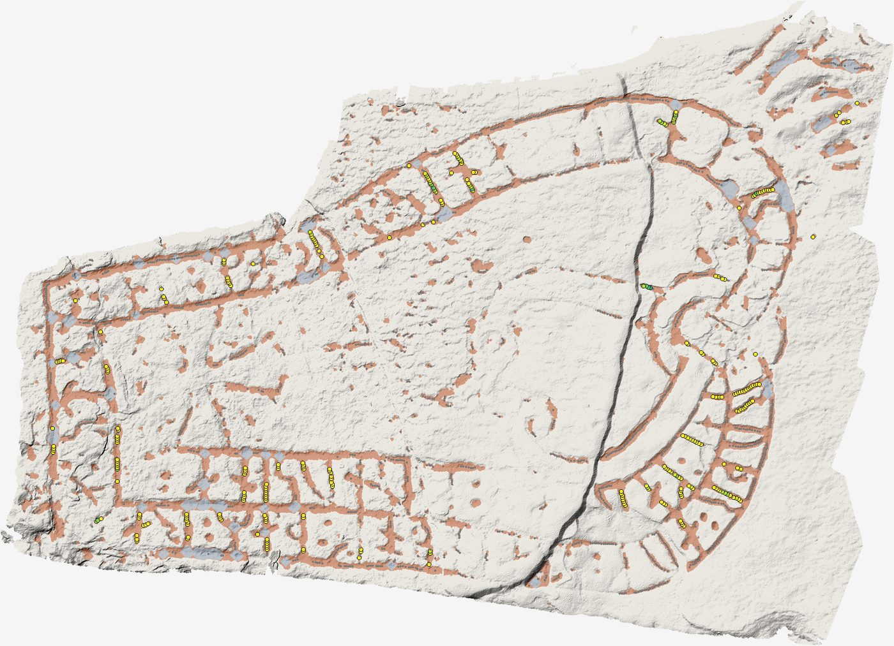

*Figur 10. Sö 128. Granskningsbild, känslighet 3.0: godkända snitt (färgade efter V-vinkel), spår (rött) och partier bedömda som för breda för ett huggspår (blått), som inte mäts.*

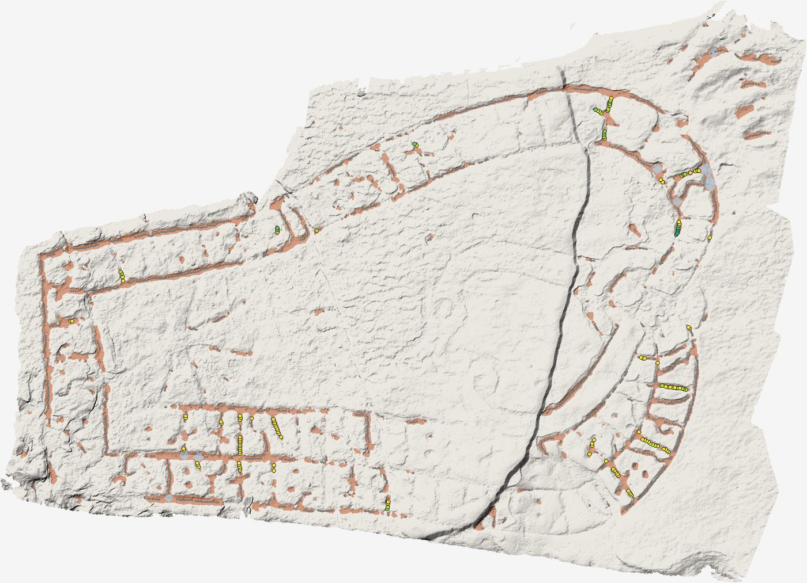

*Figur 11. Sö 128. Granskningsbild, känslighet 5.0: godkända snitt (färgade efter V-vinkel), spår (rött) och partier bedömda som för breda för ett huggspår (blått), som inte mäts.*

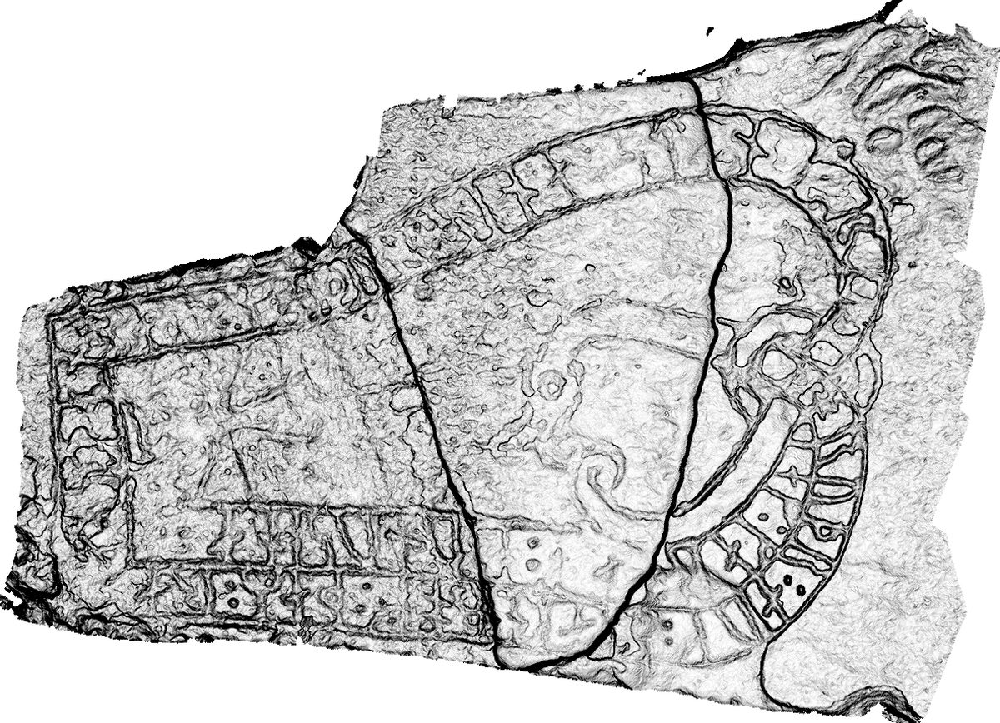

*Figur 12. Sö 128. Relief ur skanningen: det mörkaste av fyra strykljus, så att varje spår blir mörkt oavsett riktning.*

### B.4 Fel och begränsningar

- AI-text i syntes och rapport är avstängd; texterna är framräknade.
- Statistiken i R misslyckades: {"detail":"Korpusanalyserna i R är inte beräknade än. Starta dem under Statistik (R)."}
- Skanningens upplösning, utrustning och licens bör fyllas i om de saknas.
